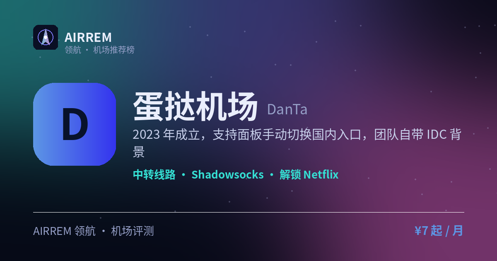

# 蛋挞机场怎么样？2026 实测：多入口进阶

> 一句话总结：少数支持在面板手动切换国内入口的机场，IDC 团队 + IEPL 专线加持；月付 ¥12/99G 起，套餐灵活可买断

👉 **[蛋挞机场 官网注册入口](https://t.rtxk.us/t/k67qxy6)** ｜ [完整评测与横向对比](https://555736.xyz/danta/)

---

## 基本信息

| 项目 | 内容 |
| --- | --- |
| 机场名称 | 蛋挞机场（蛋挞云） |
| 成立时间 | 2023 |
| 线路类型 | 公网隧道中转 + IEPL 专线 |
| 支持协议 | Shadowsocks |
| 流媒体解锁 | Netflix / Disney+ / YouTube Premium / ChatGPT / TikTok |
| 节点地区 | 港台新 · 日美韩 等，另有澳门等冷门节点 |
| 计费方式 | 包月 / 按量 |
| 起步价格 | ¥12 / 月 99G |
| 推荐场景 | 想手动切换入口、爱折腾线路的进阶用户 |

## 蛋挞机场是什么

蛋挞机场（品牌蛋挞云）成立于 2023 年，以公网隧道中转起家，后续加入 IEPL 专线提升稳定与速度，运营团队本身做 IDC，被认为技术实力较强，目前处于换站长后的持续运营阶段。

## 线路 · 协议 · 解锁

支持国内多入口智能解析，且是少数允许在面板手动切换入口的机场（如广东移动走港台新、上海电信走日美韩）；节点以常见地区为主并含澳门等冷门节点；协议以 SS 为主，兼容 Clash、Shadowrocket、Surge、QuantumultX，解锁 Netflix/Disney+/YouTube Premium/ChatGPT/TikTok。

- 可面板手动切换国内入口（少见）
- 公网隧道 + IEPL 专线
- 含澳门等冷门节点，协议以 SS 为主

> 💡 家宽节点曾因采购困难暂停，新线路陆续上线，以官网公告为准。

## 蛋挞机场 套餐价格

| 套餐 | 价格 | 说明 |
| --- | --- | --- |
| 酥皮蛋挞 | ¥12 | 月付 · 每月重置 99G · 限速 100Mbps |
| 葡式蛋挞 | ¥18 | 月付 · 每月重置 168G · 限速 200Mbps |
| 云感蔓越莓蛋挞 | ¥32 | 月付 · 每月重置 388G · 限速 300Mbps |
| 桂花紫米酒酿蛋挞 | ¥60 | 月付 · 每月重置 888G · 限速 500Mbps |
| 葡式蛋挞[不限时] | ¥40 | 一次性买断 · 不限时流量 40G · 限速 100Mbps |
| 云感蔓越莓蛋挞[不限时] | ¥79.9 | 一次性买断 · 不限时流量 79.9G · 限速 200Mbps |
| 桂花紫米酒酿蛋挞[不限时] | ¥140 | 一次性买断 · 不限时流量 1280G · 限速 300Mbps |

> 套餐分「月付按月重置」与「不限时一次性买断流量包」两类，价格以官网购买页实时为准；机场存在跑路风险，建议先月付或小额买断验证稳定性，别一上来就大额囤量。

## 优点与缺点

**✅ 优点**

- 支持面板手动切换入口，灵活度高
- 团队有 IDC 背景，技术实力较可信
- 公网隧道基础上追加 IEPL 专线
- 解锁较好、提供免费试用

**⚠️ 缺点**

- 成立时间不长且换过站长，沉淀有限
- 家宽节点曾暂停，恢复时间需看公告
- 机场行业存在跑路风险，建议先用月付或小额套餐验证稳定性，别一上来就大额年付。

## 适合谁 / 不适合谁

| 👍 适合 | 👎 不适合 |
| --- | --- |
| 爱自己折腾、对比不同入口的进阶用户 | 只想开箱即用、不想手动选入口的新手 |
| 需要澳门等冷门节点、想先免费试用 | 偏好老牌机场的用户 |

## 我们的结论

亮点是可在面板手动挑国内入口（同类少见），团队做 IDC 出身、后续加入 IEPL 专线，诚意在线；套餐灵活，月付低至 ¥12/99G，也提供 ¥40 起的不限时买断流量包；新站且换过站长，建议先免费试用/月付观察过渡期。

## 常见问题

**Q：可以免费试用吗？**

A：可以，官网支持注册后免费试用，建议先测线路速度再购买。

**Q：手动切换入口是什么？**

A：可在面板自选走哪个国内入口（如广东移动、上海电信）连接落地节点，方便按自身网络挑最优线路。

## 同类机场推荐

拿不定主意？可以再看看这几家同类型的：

- **[守候](https://555736.xyz/shouhou/)** — 稳健老用户 / Emby 影音，¥15 起
- **[自由猫](https://555736.xyz/freecat/)** — 日常主力，¥6 起
- **[淘气兔](https://555736.xyz/taoqitu/)** — 联通移动用户，¥7.8 起

全部 38 家机场的横向对比与选购方法论：**[信号塔 SignalTower · 机场大全](https://555736.xyz/airports/)**

---

数据更新：2026-07 ｜ 价格、套餐与优惠码以官网实时为准 ｜ 本仓库为第三方评测整理，与 蛋挞机场 官方无隶属关系 ｜ 请遵守当地法律法规使用网络服务。

关键词：蛋挞机场、蛋挞云、手动切换入口、IEPL机场、中转机场、机场推荐
